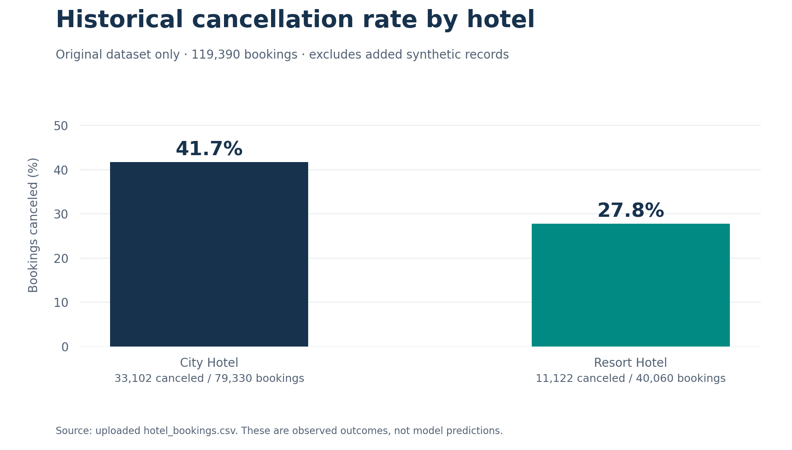
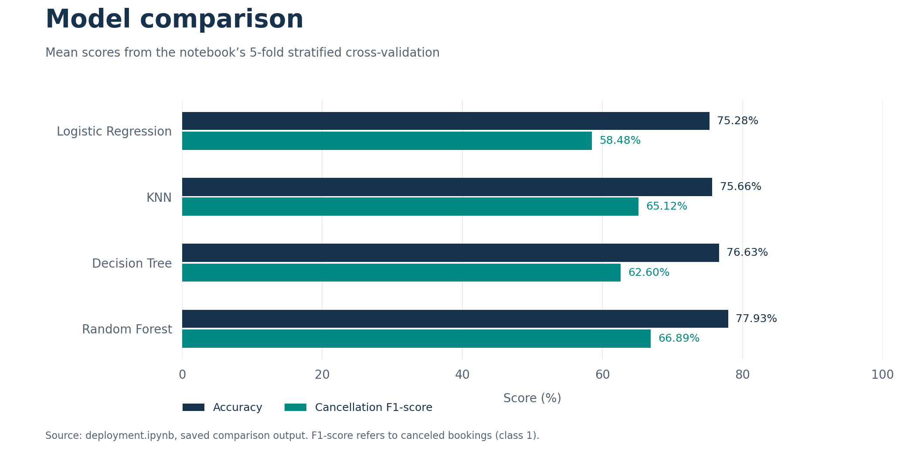

# StayWise — Hotel Booking Cancellation Prediction

**Course:** Data Science for Business Applications

StayWise estimates whether a hotel booking may be canceled. The project combines data analysis, machine learning, and a Streamlit application to help hotel staff prioritize bookings that may need follow-up.

[Open the Streamlit application](https://deployment--hotel-booking.streamlit.app/)

## Business problem

**Business Question:**
Which hotel bookings are likely to be canceled, so hotel staff can prioritize confirmation follow-ups and improve room availability planning?


Cancellations make it difficult for hotels to plan occupancy, staffing, and expected revenue. Estimating cancellation risk can help staff prioritize confirmation calls and other follow-up activities.

Predictions support staff judgment; they do not guarantee a guest's future behavior.

## Project objectives

- Explore booking patterns and cancellation rates.
- Prepare numerical and categorical booking data.
- Compare classification models.
- Estimate cancellation probabilities for individual bookings.
- Present results through an interactive application.

## Dataset

The project uses hotel booking data stored in `hotel_bookings.csv`.

The original dataset contained **119,390 records**. An additional **130,610 synthetic records** were generated, creating a combined dataset of **250,000 records**. Synthetic records are generated examples, not additional real customer bookings.

The target variable is `is_canceled`:

| Value | Meaning |
|---|---|
| `0` | Booking was not canceled |
| `1` | Booking was canceled |

The model uses 22 features:

| Category | Features |
|---|---|
| Reservation | Hotel, lead time, arrival month, arrival year, arrival day, weekend nights, week nights |
| Guests | Adults, children, babies, country |
| Booking arrangements | Meal, market segment, distribution channel, reserved room type, deposit type, agent, customer type, average daily rate |
| Booking history | Repeated guest, previous cancellations, previous bookings not canceled |

## Historical cancellation patterns



In the original dataset, **41.7% of City Hotel bookings** and **27.8% of Resort Hotel bookings** were canceled.

This graph uses the original 119,390 bookings and excludes the added synthetic records. It shows observed outcomes, not model predictions. The difference does not establish that hotel type causes cancellations.

## Data preparation

The saved prediction pipeline combines preprocessing and classification.

### Numerical features

- Missing values are filled using the median.
- Values are standardized using `StandardScaler`.

### Categorical features

- Missing values are filled using the most frequent category.
- Categories are transformed using `OneHotEncoder`.
- Unknown categorical values are handled by the encoder.

Saving preprocessing with the model helps ensure application inputs receive the same transformations used during training.

## Model development

Four classification models were compared:

1. Logistic Regression
2. K-Nearest Neighbors
3. Decision Tree
4. Random Forest

Models were evaluated using accuracy, precision, recall, and F1-score. The exploratory modeling workflow used 200,000 training records and 50,000 testing records from the combined dataset.

### Cross-validation results

These results come from the notebook's saved **five-fold stratified cross-validation comparison**. Precision, recall, and F1-score refer to canceled bookings, class `1`.

| Model | Accuracy | Precision | Recall | F1-score |
|---|---:|---:|---:|---:|
| Logistic Regression | 75.28% | 77.86% | 46.83% | 58.48% |
| K-Nearest Neighbors | 75.66% | 69.68% | 61.11% | 65.12% |
| Decision Tree | 76.63% | 77.28% | 52.62% | 62.60% |
| Random Forest | 77.93% | 75.62% | 59.97% | 66.89% |



Random Forest achieved the highest accuracy and F1-score in this comparison and was selected for the application. The saved classifier uses **200 decision trees**.

These are recorded notebook evaluation results, not a new evaluation of the deployed pipeline or a guarantee of future performance.

### Understanding the metrics

- **Accuracy:** the proportion of all bookings classified correctly.
- **Precision:** among bookings predicted to cancel, the proportion that actually canceled.
- **Recall:** among bookings that actually canceled, the proportion identified by the model.
- **F1-score:** a measure balancing precision and recall.

## Application features

The application is intended for hotel staff.

### Overview

Displays historical booking summaries and charts to help staff explore booking patterns.

### Predict a Booking

Staff enter information across three tabs:

1. **Reservation details:** hotel, arrival date, lead time, nights, room price, room type, and deposit.
2. **Guest details:** guest counts, country, meal, market segment, distribution channel, customer type, and agent.
3. **Booking history:** returning-guest status, previous cancellations, and previous bookings not canceled.

After selecting **Predict cancellation**, the application displays:

- Estimated cancellation probability.
- The model's predicted class.
- A follow-up suggestion.
- The submitted booking details.

### About the Model

Explains the model, input features, recorded evaluation results, and limitations.

## Follow-up threshold

Staff can choose the probability threshold used to flag bookings for follow-up.

For example, with a threshold of **50%**:

| Estimated cancellation probability | Follow-up suggestion |
|---|---|
| 65% | Flagged for follow-up |
| 30% | Usual confirmation process |

Lowering the threshold flags more bookings. Increasing it flags fewer bookings.

The threshold changes the follow-up suggestion. It does not retrain the model or change the class returned by the model's prediction method. The default threshold is a demonstration setting, not a proven optimal business threshold.

## Project files

| File | Purpose |
|---|---|
| `deployment.ipynb` | Data preparation, exploration, model development, and evaluation |
| `application.py` | Streamlit application |
| `hotel_bookings.csv` | Booking dataset |
| `hotel_booking_model.pkl` | Saved preprocessing and classification pipeline |
| `requirements.txt` | Required Python packages |
| `.gitattributes` | Git LFS configuration |
| `.gitignore` | Files excluded from version control |
| `README.md` | Project documentation |
| `model_comparison.png` | Cross-validation comparison chart |
| `cancellation_rate_by_hotel.png` | Historical cancellation-rate chart |

## Packages used

| Package | Purpose |
|---|---|
| pandas | Data loading, cleaning, and tabular inputs |
| NumPy | Numerical operations and missing values |
| scikit-learn | Preprocessing, model training, and evaluation |
| joblib | Saving and loading the trained pipeline |
| Plotly | Interactive application charts |
| Matplotlib | Static visualizations |
| Seaborn | Exploratory visualizations |
| Streamlit | Interactive web application |

The saved model uses **scikit-learn 1.6.1**.

## Run locally

Clone the main branch:

```bash
git clone --branch main https://github.com/raAlshehhi/deployment--Hotel-Booking.git
cd deployment--Hotel-Booking
```

With Git LFS installed, retrieve the saved model:

```bash
git lfs install
git lfs pull
```

Using a compatible Python environment, install the dependencies and start the application:

```bash
python -m pip install -r requirements.txt
python -m streamlit run application.py
```

Keep `hotel_booking_model.pkl` and `hotel_bookings.csv` in the same folder as `application.py`.

## Streamlit deployment

[Open StayWise](https://deployment--hotel-booking.streamlit.app/)

| Branch | Purpose |
|---|---|
| `main` | Full project, training notebook, dataset, documentation, and saved model |
| `streamlit-runtime` | Deployment version that downloads the model after startup |

The deployment branch downloads the same trained model from a pinned commit in the repository. It streams the download to disk, verifies the expected file size and SHA-256 checksum, loads the pipeline using memory mapping, and caches it with `st.cache_resource`.

This separates the large-model download from repository cloning. It does not retrain or replace the model. A fresh cloud machine may need to download the model again; cloud memory and download-bandwidth limits still apply.

### Intended cloud configuration

| Setting | Value |
|---|---|
| Repository | `raAlshehhi/deployment--Hotel-Booking` |
| Branch | `streamlit-runtime` |
| Main file | `application.py` |
| Python version | `3.11` |
| scikit-learn version | `1.6.1` |

Verify a prediction on the public app before treating deployment as complete. Compare its result with the original local application using identical inputs.

## Limitations

- Predictions are estimates, not certain outcomes.
- The combined dataset includes synthetic records.
- Randomly splitting real and synthetic records may produce optimistic results if related examples appear in both training and evaluation data.
- Evaluation on an untouched real dataset would provide stronger evidence of generalization.
- Preprocessing fitted before cross-validation can also make results optimistic. Future evaluation should fit the complete pipeline separately within each fold.
- The gap between training and testing performance indicates a risk of overfitting.
- Future bookings may differ from historical training data.
- The model's large size creates download and memory constraints during deployment.
- Follow-up suggestions require staff judgment and should not automatically trigger penalties or cancellation of reservations.

## Future improvements

- Evaluate the complete pipeline on an untouched real-data holdout.
- Fit preprocessing within each cross-validation fold.
- Assess whether predicted probabilities are well calibrated.
- Select a follow-up threshold using business costs and staff capacity.
- Monitor performance as new real booking outcomes become available.
- Investigate smaller models while comparing their predictive performance.

## Conclusion

StayWise demonstrates how data science can support hotel booking management through data exploration, preprocessing, classification, evaluation, and an interactive application.

Its purpose is to help hotel staff identify bookings that may benefit from follow-up while keeping the final decision with staff.
